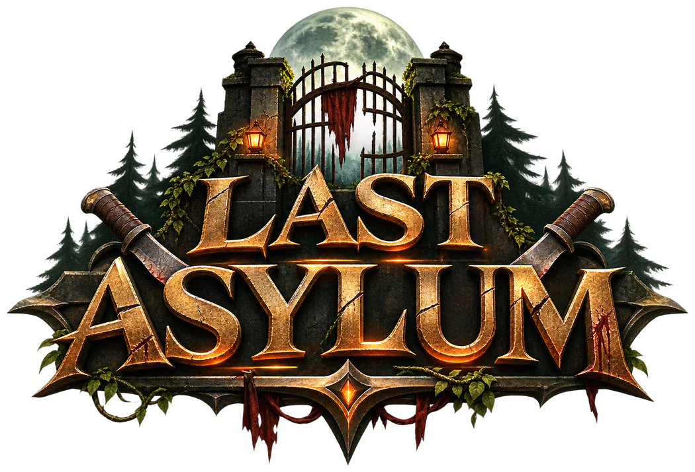

**Game survival 3D berbasis browser**

**[Mainkan LAST ASYLUM secara online](https://lastasylumgame.netlify.app/)**

## Website Resmi

LAST ASYLUM dapat dimainkan langsung melalui website resmi:

**https://lastasylumgame.netlify.app/**

## Tentang LAST ASYLUM

**LAST ASYLUM** adalah game survival 3D yang menggabungkan petualangan, perburuan monster, pengelolaan sumber daya, dan pengembangan markas dalam sebuah hutan misterius. Pemain berperan sebagai pemburu yang harus bertahan hidup sekaligus menjalankan usaha makanan bagi para pelanggan yang datang ke markas.

Di luar pagar markas, pemain menghadapi makhluk berbahaya untuk memperoleh daging. Setiap **3 daging hewan** dapat dimasak menjadi **1 sup**. Sup kemudian dijual kepada pelanggan yang tiba melalui jalur khusus, sementara koin hasil penjualan dapat dikumpulkan dan digunakan untuk meningkatkan kemampuan karakter.

Permainan memberi kebebasan dalam menjelajahi lingkungan, tetapi setiap tindakan memiliki konsekuensi. Pemain juga dapat menyerang manusia; jika daging yang tercemar digunakan untuk memasak, permainan akan berakhir akibat keracunan.

## Pengalaman Bermain

- **Eksplorasi dan pertarungan 3D** di lingkungan hutan dengan ancaman monster.
- **Berburu, memasak, dan berdagang** melalui sistem bahan, sup, pelanggan, dan koin.
- **Markas interaktif** dengan gerbang terpisah untuk pemburu dan pelanggan.
- **Peningkatan karakter** menggunakan koin yang diperoleh dari penjualan.
- **Kontrol laptop dan perangkat seluler**, termasuk pengaturan tombol keyboard.

Game dibuat menggunakan **JavaScript dan WebGL** untuk dimainkan melalui browser yang mendukung grafis 3D.

---

**Created by [LamberthRumpaidus](https://github.com/lamberthrumpaidus)**

[GitHub Profile](https://github.com/lamberthrumpaidus)

